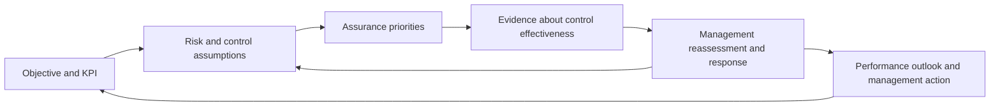
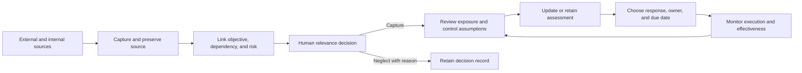

# Beyond Compliance: Memaksimalkan Potensi AI dalam Mengawal Strategi dan Risiko Organisasi
## Using AI to Capture Signals for Effective Risk Management

Seminar narrative and deck/app design baseline · 18 October 2026 · 60 minutes · English deck

This is the narrative baseline for the rebuilt three-organization application and 42-slide HTML deck. Current operating instructions and implementation boundaries are in [seminar-workshop.md](seminar-workshop.md). The opening covers the broader use of AI in audit and assurance; the hands-on narrows to SIGNAL risk decisions. Separate assurance applications are outside this exercise.

## 1. The argument

We already invest in performance management, risk management, and assurance. The practical test is whether evidence from one changes a timely decision in another. When those connections are weak, substantial effort produces records without enough influence on outcomes.

AI can help risk management respond to changing conditions: find signals, relate them to organizational dependencies and objectives, explain why a review may be needed, and propose a response. Management decides relevance, assessment, and action. Assurance tests controls and the effectiveness of the response.

**The seminar's promise:** participants follow a traceable chain from a real event to an objective, a risk review, and an owned mitigation action. A reasoned neglect decision or unchanged score is equally valid.

Beyond Compliance is the headline. GRC 5.0 can remain a supporting concept/brand; do not represent it as a formally recognized regulatory maturity level.

## 2. Theory, diagnostic questions and research evidence

Slides 3–4 introduce AI oversight and AI-enabled supervision (SupTech), with sources from OECD (2026) and BIS FSI Insights 37 (2021). AI can be both the object of oversight and a tool supporting it. Internal oversight is presented as an adaptation of financial-sector SupTech; human judgment and accountability remain essential.

Slide 5 compares authority use cases: ECB Athena/Heimdall, PRA cognitive search and the FINMA GenAI desk-review proof of concept. Each card links to a primary authority source and identifies status and publication date.

Slide 6 narrows the scope to SIGNAL as a risk-management use case: protect an objective, connect changing evidence to risk assumptions, and retain human ownership of assessment and response.

Slides 7–8 introduce performance, risk and assurance as connected disciplines, supported by OCEG, COSO ERM and the IIA Three Lines Model. Slide 9 asks whether the handoffs actually influence decisions. Its explanations remain static while the paths loop.

Slides 10–12 present strategic-usefulness, assurance-alignment and risk-reporting evidence. Source populations and limitations remain explicit. The research transitions directly to the SIGNAL framework on slide 13. No corporate-collapse case is included.

SIGNAL illustrates timely evidence, contextual screening, human review, reassessment and an owned response. A score is an ordinal judgment, not a numerical KPI forecast. The app currently uses transparent relevance rules rather than a connected language model.

## 3. Frameworks that carry the story visually

### Three disciplines, one objective

Show three lanes: performance (objective/KPI), risk (exposure/control assumptions), and assurance (control evidence/findings). First reveal missing handoffs; then animate explicit links around a shared objective.

This is a decision framework, not a claim that all relationships are linear. Performance information also feeds risk review. Auditors retain independence; management owns assessment and response.

### The signal-to-action loop

AI's intended role is retrieval, extraction, contextual linking, and proposals. The current workshop uses transparent rules; a model is not connected. Explain this plainly once and keep the suggestion's provenance inspectable. The exercise demonstrates a workflow an AI agent would support; do not call rule-based screening live model reasoning.

| Distinction | Implication |
|---|---|
| Signal versus verified exposure | A credible report does not establish our exposure. Check geography, time, assets, suppliers, and dependencies. |
| Current KPI versus forward-looking risk | Performance actuals and uncertainty about future achievement differ. Risk scores are not numerical KPI forecasts. |
| Approved plan versus effective protection | Approval creates a commitment. Current risk only decreases after implementation/effectiveness evidence justifies reassessment. |
| More reports versus more independent evidence | Several articles about one event are corroboration, not several separate reasons to raise a score. |

## 4. Progressive experience

1. Establish the three disciplines, their weak handoffs and the research evidence.
2. Introduce the SIGNAL source-to-decision framework.
3. Join, choose an organization and select objectives.
4. Inspect risks, starting mitigations and news sources.
5. Review the shared real news event. Approve or decline each suggested risk link; capture notes are optional.
6. Capture opens the affected risk. Accept the suggested map position or choose a custom score with your own rationale. Keeping a score also requires a reason.
7. An above-tolerance assessment prompts a mitigation decision. Declining the suggestion is saved; approving a plan records its owner, deadline and expected protection.
8. Show the first-case dashboard, then release the wider external and internal signals. Participants may continue independently; presentation proceeds without a review break.
9. Explain the SIPT direction: one risk register through RP, continuous evidence through CMCA, AI-assisted human review and effective early warning.

Slide timing estimates and the participant countdown are omitted. Participants can work at their own pace.

## 5. Strategic choices, not operational interruptions

The hands-on exercise asks whether a **growth thesis, market choice, business model or capital commitment** is still credible when new evidence arrives. Daily delivery, backup and warehouse incidents are no longer the selected risks.

All three organizations are fictional Indonesian teaching scenarios. Revenue weights, targets, scores, tolerance, plans and internal documents are exercise assumptions. External news is real and dated. The executable catalog is `app/shared/strategicScenario.ts`.

| Organization | Strategic exposure | Objectives | Risks |
|---|---|---|---|
| **PT Nusa Logistik Indonesia** | Export forwarder; US-bound exporters support 45% of revenue; proposed export hub | L1: revenue +15%, contribution margin ≥12%. L2: ≥30% new contracted revenue outside the US corridor; downside approval before hub investment | Trade-policy demand shock 12; corridor profit-model erosion 8; unqualified diversification 8; stranded hub investment 10 |
| **PT Pangan Ritel Nusantara** | Processed seafood exporter; 60% of export sales to US buyers; product classifications and contract terms must be checked | P1: export revenue +12%, gross margin ≥18%. P2: non-US share ≥40%; qualify two new markets by Q4 | Tariff-driven competitiveness loss 12; currency/pricing assumptions 8; unqualified market entry 8; persistent concentration 9 |
| **PT Cakrawala Digital Indonesia** | Domestic enterprise/public-sector software; no goods exports, US buyers or verified dependence on US-bound exporters | D1: recurring revenue +20%, key-account retention ≥90%. D2: win three regulated-sector accounts; validate data requirements before commitments | AI commoditization 12; customer budget reprioritization 8; data-governance market constraints 10; model-vendor dependence 9 |

Participants choose one organization and at least one objective. Recommend the first objective for the common 12 → 16 worked example. The tariff case can also challenge the logistics hub-investment case or the seafood company's market concentration. Their starting scores differ; do not force every participant to obtain 16. Risks, owners, baseline assumption-validation plans and controls are supplied.

## 6. First guided signal: a strategic trade shock

**ANTARA Jawa Barat, 3 April 2025, 10:03 WIB:** “Indonesia kena kenaikan tarif AS 32 persen” [R9]. The report covers the 2 April announcement, with the country-specific tariff scheduled for 9 April at publication. The exercise is explicitly **as of 8 April 2025**. This is a historical announcement, not a claim about the current tariff rate.

The shared record is `website/assets/data/seminar-case.json`. Display the original article link, headline, date and attributed article photograph. The deck's article brief is not labelled a browser screenshot. Separate reported facts from fictional company exposure.

1. Ask: which growth assumptions does this challenge? Does the announcement establish a loss, or a reason to investigate?
2. Reveal two potentially affected export-dependent strategies and the domestic-software contrast. Tariffs on goods can affect freight customers' demand; do not call them a tax on freight services.
3. Presenter releases the guided case. Every participant receives it, including those with no suggested link, so a reasoned neglect is possible.
4. Open the original source. Verify timing, covered products, contracts, customer intentions, revenue concentration and available strategic options.
5. Capture or neglect with a reason. Capture alone leaves the assessment unchanged.
6. For the first export-growth risk, consider likelihood 3 → 4 with impact 4, only if the growth case depends on the exposed demand and effective protection is unverified. Keep/customize/accept remain available. The announcement does not imply 32% revenue loss or a measured probability.
7. Exercise tolerance is ≤12. A proposed 16 prompts an owned response: rebase the forecast, qualify non-US demand, review pricing and approve investment decision gates.
8. Save a response with owner, deadline, expected effect and evidence requirements. A one-point likelihood reduction projects 12, while current assessment remains 16 until explicitly reassessed against evidence.
9. Return to the objective: explain the mechanism threatening revenue growth, margin or investment returns. Do not manufacture KPI actuals from a risk score.

For the domestic software company, no established direct goods-tariff exposure is a valid contrast. Indirect exposure remains a question to verify. That company receives its own strategic signals in the next round.

## 7. Wider strategic evidence

### External sources

The default **Load strategic case news** action prepares eight verified articles representing seven events, all published by the 8 April 2025 cutoff:

- Trade-policy response and sector assessment: ANTARA and Kompas corroboration of the guided event.
- Rupiah pressure: uncertain net effect; inspect receipts, imported inputs and repricing.
- New export destinations: diversification opportunity, not proof of contracted demand.
- Trade diversion: a published concern, not a demonstrated market-share loss.
- Budget efficiency: revalidate funded demand; do not assume all technology contracts are cancelled.
- DeepSeek: revalidate differentiation and willingness to pay; reported model-training costs are not total ownership costs.
- Expected PDP implementing rules: assess market-entry requirements; an expected rule is not an enacted obligation.

All source links, dates, summaries and directional screening metadata are in `website/assets/data/strategic-news.json`. ANTARA, detik, Kompas and CNN Indonesia remain selectable. CNN has no verified article in this case pack, so coverage is honestly zero. Publisher selection applies before release; corroborating coverage is grouped as one event. Participants review useful evidence at their own pace, without a capture quota.

**Capture current strategic news** is a separate on-demand Google News RSS mode, retaining actual dates and up to 24 unique results. It does not pretend that current headlines occurred in the April 2025 replay. Inspect source coverage and relevance before releasing. The app uses transparent grouped-term relevance rules, not a connected language model. Social listening remains an unconnected future source.

### Internal sources

| Source | Strategic example | Management decision |
|---|---|---|
| Strategy minutes / periodic report | Eight forecast deals still assume unchanged US-bound demand | Revalidate the growth case and resource commitments |
| Audit report | No approved tariff downside sensitivity or key-customer confirmation | Challenge confidence in the forecast and investment gates |
| Continuous Assurance | 8/20 forecast deals lack updated trade-policy assumptions = 40%, against a 20% review threshold | Confirm the business-case exceptions, then revisit the linked risk |

There are three evidence types for each of 12 risks, with readable source documents. CA uses configured teaching inputs and exposes numerator, denominator, threshold, metric and exception references. It is automated, with human confirmation before capture, and is not a claim of a production connector. Report, audit and CA records challenging the same assumption share an event key to prevent repeated escalation.

Evidence can justify a higher, lower or unchanged assessment. Record the source, reasoning, owner and next review. Measure the quality of decisions and protection, rather than the number of captured items.

## 8. App design contract

### Audience: three main menus

**Dashboard:** selected objectives/KPI targets and actuals if supplied; exposure relative to tolerance; risks awaiting review; actions due/overdue; and decision history. A compact heat map complements the risk list. Distinguish observed current assessment from projected residual assessment. Never infer KPI actuals or completed improvement from approved plans.

**Risk Monitoring**, with two tabs:

- **Risks:** table of risk, objective, current score, tolerance indicator, owner, and pending signals. Row accordion opens evidence review, capture/neglect, reassessment, and response. Keep controls/history visible. Decisions retain evidence, reason, actor, and timestamp.
- **Mitigation plans:** table of plan, linked risk/objective, owner, due date, status, expected effect, and effectiveness evidence. Accept/customize suggestions. Proposed or approved plans remain separate from verified protection.

**Risk Trigger:** source configuration and capture/triage status. External news/social; periodic/incident reports; audit reports; automated CA. Risk-linked review is accessible from Risk Monitoring without duplicated decisions/queues. Source changes apply at a documented batch boundary, not by silently deleting reviewed evidence.

For phones, use three-item bottom navigation and compact risk/signal rows; use tables on larger screens. Details must be readable without horizontal scrolling. Badges distinguish news, social, report, audit, and CA.

### Admin/presenter

Preserve separate routes: `/admin`, `/admin/sessions/CODE`, `/audience`, and `/audience/sessions/CODE`. QR and deck joins target audience paths. Keep session ownership and private workspaces.

Controls: create/resume; share QR; inspect source coverage; pin/preview news; preview exposure for each organization/objective; release guided item; release external batch; release internal evidence; track aggregate progress; display anonymized outcomes. Releases are idempotent. Slower participants can finish earlier work.

The presenter cannot accept signals or edit assessments/plans for participants. Default session summaries do not expose another participant's private rationale.

Use durable IDs for organizations, objectives, risks, events, signals, sources, decisions, assessments, and plans. A signal may affect several objectives/risks. Relevance scores differ from risk scores. Publication/event/capture/replay timestamps differ.

Acceptance checks: multiple-objective selection; two exposed/one unexposed case; no score update without a human decision; no decrease from plan approval; event grouping; stale-news handling; openable sources; mobile usability; private workspaces; owner-only release; duplicate-release protection; refresh/rejoin persistence; actual-phone LAN access.

## 9. Deck storyboard

Five section markers orient the audience.

| Slide | Section | Content |
| --- | --- | --- |
| 1 | Opening | Beyond Compliance |
| 2 | Opening | Meet your speakers |
| 3 | Opening | Our route from evidence to action |
| 4 | AI in audit & assurance | AI in audit & assurance |
| 5 | AI in audit & assurance | Two roles for AI in supervision |
| 6 | AI in audit & assurance | Three layers of frontier AI risk |
| 7 | AI in audit & assurance | Supervise AI: what must we examine? |
| 8 | AI in audit & assurance | SupTech: from more data to focused supervision |
| 9 | AI in audit & assurance | SupTech in practice: authorities using AI |
| 10 | AI in audit & assurance | Our use case: AI for risk management |
| 11 | The disconnect | The disconnect |
| 12 | The disconnect | Three disciplines. One purpose. |
| 13 | The disconnect | Can evidence cross the boundaries? |
| 14 | The disconnect | Shared goals. Disconnected decisions? |
| 15 | The disconnect | 89% did not report a unique strategic advantage. |
| 16 | The disconnect | 49% of business executives see an assurance alignment gap. |
| 17 | The disconnect | Risk reporting can become a compliance exercise. |
| 18 | The SIGNAL model | The SIGNAL model |
| 19 | The SIGNAL model | SIGNAL: from evidence to action |
| 20 | Lead the decision | Lead the decision |
| 21 | Lead the decision | One organization. Two signal streams. A complete decision cycle. |
| 22 | Lead the decision | Join the session |
| 23 | Lead the decision | Which organization will you lead? |
| 24 | Lead the decision | The risk and the response are already connected |
| 25 | Lead the decision | A trade-policy shock. Which growth plans are exposed? |
| 26 | Lead the decision | Which organization is affected by this news? |
| 27 | Lead the decision | The alert reaches your risk. You decide whether to capture it. |
| 28 | Lead the decision | A changed assumption can move the assessment |
| 29 | Lead the decision | The action follows the exposed dependency |
| 30 | Lead the decision | Approval creates a commitment. Effectiveness needs evidence. |
| 31 | Lead the decision | The dashboard shows decisions and commitments |
| 32 | Lead the decision | More signals. Better risk decisions. |
| 33 | SIPT: Kemenkeu's direction | SIPT: Kemenkeu's direction |
| 34 | SIPT: Kemenkeu's direction | SIPT: connecting control information across Kemenkeu |
| 35 | SIPT: Kemenkeu's direction | Integrated Internal Control Framework (SPIT) |
| 36 | SIPT: Kemenkeu's direction | One risk register. One view of risk. |
| 37 | SIPT: Kemenkeu's direction | From periodic snapshots to continuous risk evidence |
| 38 | SIPT: Kemenkeu's direction | The review pattern: exception → confirmation → risk decision |
| 39 | SIPT: Kemenkeu's direction | CMCA is one signal stream. Reports and assurance add context. |
| 40 | SIPT: Kemenkeu's direction | AI connects the evidence. People own the decision. |
| 41 | SIPT: Kemenkeu's direction | Follow one risk across the information flow |
| 42 | SIPT: Kemenkeu's direction | A warning is effective when it changes a timely decision |
| 43 | SIPT: Kemenkeu's direction | One view of risk. Shared evidence. Owned decisions. |
| 44 | SIPT: Kemenkeu's direction | Sources behind the argument |

## 10. SIPT: the institutional direction

### Presenter-supplied platform direction

- **Risk Platform:** the single source of the risk register, enabling one view of risk. Objectives, risk context, owners, assessments and response history provide a shared reference; management retains ownership.
- **CMCA Platform:** a mainstream route for continuous monitoring of risk events. Checks and exception evidence link to registered risks so monitoring and assurance can use the same context.
- **AI assistance:** relate internal/external evidence to the shared objectives and risks, explain relevance and uncertainty, and suggest assessment/response options. A human validates the signal and approves any change.
- **Feedback:** approved reviews and response evidence return to the register and inform monitoring. An alert alone is not assurance, a score change or a verified outcome.

These platform relationships are the direction described by the presenter. Public references support SPIT/SIPT terminology and the institutional early-warning objective, not the live deployment of the demonstrated AI flow.

### Public source basis

PMK 83/2024 establishes SPIT. BaTii's strategy defines **SIPT ? Sistem Informasi Pengendalian Terintegrasi** as information-system support for SPIT [R6, R10, printed page 10]. DJKN?s public explanation links integrated control to effective early warning, current risk profiles and cross-line oversight [R8]. These sources were rechecked on 19 October 2026.

### Closing message

The first ANTARA case shows the decision pattern at a small scale. The institutional direction connects that pattern across Kemenkeu: RP provides shared risk context, CMCA supplies continuous evidence, AI supports relevance review, and accountable people decide and act.

Management maintains risk context and owns the response. UKI supports useful monitoring and escalation. Itjen independently challenges control and response effectiveness. Technology and data teams enable dependable access, references and traceability. Ask what evidence each unit can contribute to protect a shared objective.

No generic 30-day pilot or audience waiting period is part of this closing section. Participants can continue exploring their inboxes as the presentation proceeds or after it ends.

## References and claim boundaries

Sources checked online on 18 October 2026. Historical instruments establish longevity and are not all represented as currently operative. English descriptions are paraphrases, not official translations. This is a seminar evidence base, not a comprehensive current-law opinion.

- **[R1]** [DJKN, Realistisnya Timeline Pencapaian Bantu Target Terlampaui](https://www.djkn.kemenkeu.go.id/berita/baca/5203/Realistisnya-Timeline-Pencapaian-Bantu-Target-Terlampaui.html). Official 2014 coverage records e-performance use; does not establish first launch or complete ministry-wide coverage.
- **[R2]** [DJKN, Manajemen Kinerja berdasarkan KMK 300/KMK.01/2022](https://www.djkn.kemenkeu.go.id/kanwil-aceh/baca-artikel/15808/Manajemen-Kinerja-di-Lingkungan-Kementerian-Keuangan-berdasarkan-KMK-300KMK012022.html). Official explanation of performance management and its framework.
- **[R3]** [JDIH, PMK 191/PMK.09/2008](https://jdih.kemenkeu.go.id/dok/191-pmk-09-2008). Historical risk-management instrument; existence does not prove consistent implementation since 2008.
- **[R4]** [DJKN, Pengelolaan Risiko](https://www.djkn.kemenkeu.go.id/kanwil-jakarta/baca-artikel/14069/Pengelolaan-Risiko-). Official explanation of KMK 577/KMK.01/2019 and its objective/performance connection.
- **[R5]** [JDIH, PMK 109/PMK.09/2021, original text](https://jdih.kemenkeu.go.id/api/download/0bba2ab5-08ea-4f7e-8296-cfc5457bfa37/109~PMK.09~2021Per.pdf). Articles 1, 2, 4, 9, and 12 support the assurance-risk-objective relationship; the preamble identifies its 2016 predecessor. Does not establish effectiveness in practice.
- **[R6]** [JDIH, PMK 83 Tahun 2024](https://jdih.kemenkeu.go.id/dok/pmk-83-tahun-2024). Official SPIT metadata: established 18 October 2024; effective 1 January 2025.
- **[R7]** [DJPb official listing of KMK 1/KM.9/2025](https://djpb.kemenkeu.go.id/kppn/mukomuko/id/data-publikasi/daftar-peraturan/3108-keputusan-menteri-keuangan-republik-indonesia-nomor-1-km-9-2025-tentang-petunjuk-pelaksanaan-sistem-pengendalian-intern-terintegrasi-di-lingkungan-kementerian-keuangan.html). Supports identification/title. Check its linked original before adding article-specific quotations.
- **[R8]** [DJKN, SPIT dalam rangka membangun EWS yang lebih efektif](https://www.djkn.kemenkeu.go.id/kanwil-rsk/baca-artikel/17762/Sistem-Pengendalian-Intern-Terintegrasi-SPIT-Dalam-Rangka-Membangun-Sistem-Peringatan-Dini-EWS-yang-lebih-efektif.html). Discusses objectives/KPIs, risk profiles, oversight-based reassessment, and three-line integration. Supports direction, not deployed AI functionality.
- **[R9]** [ANTARA Jawa Barat, Indonesia kena kenaikan tarif AS 32 persen](https://jabar.antaranews.com/berita/594405/indonesia-kena-kenaikan-tarif-as-32-persen), 3 April 2025, 10:03 WIB. Original announcement replayed as of 8 April 2025; not the current tariff rate. Company exposure and scores are exercise assumptions.
- **[R10]** [BaTii, KEP-39/TI/2025: Renstra 2025–2029](https://batii.kemenkeu.go.id/api/Medias/68f3f086-ae7c-40c1-8acb-251c0e16dacd), printed page 10 (PDF page 10). Explicitly describes SIPT as supporting SPIT; does not establish operational status or the demonstrated AI workflow.

### Supervise AI teaching source

Two slides after the AI supervision bridge adapt the presenter's `Understanding Frontier AI - IHT OJK 2026.pptx`, displayed slides 26 and 48-50 / 64. The first explains why oversight is needed through model, misuse, and operational/systemic risk. The second covers system scope, accountability, data, authority and monitoring. The approval-gate example has been removed. The original SPIT artwork is unchanged and appears on slide 35 of 44.
